# Laporan Tugas 3 — Segmentasi Instance dengan Deep Learning (Evaluasi CPMK 3)
Muhammad Fathur Aziz — 5054241043

> Draf laporan ini disusun dengan bantuan AI (Claude) dari angka di `bukti/` dan output notebook; lihat [`docs/Penggunaan_AI.md`](docs/Penggunaan_AI.md). Semua angka dapat ditelusuri ke file CSV yang disebut di tiap bagian.

## Ringkasan

- Tiga model dari dua keluarga arsitektur dilatih pada *Panoptic Indoor Segmentation* v5: **YOLO11n-seg** dan **YOLOv8n-seg** (one-stage) serta **Mask R-CNN R50-FPN v2** (two-stage). Variabel NRP (digit 3) berupa **jumlah data latih 25/50/100%** diterapkan pada ketiganya, sehingga ada 9 run dengan total **154,4 menit GPU T4**.
- Dengan 100% data, YOLO11n-seg terbaik di test set buatan sendiri (mask mAP50-95 **0,148**, vs Mask R-CNN 0,117 dan YOLOv8 0,097). Di test asli, YOLO11 dan Mask R-CNN hampir seri (0,094 vs 0,095), tetapi YOLO11 ±5,5× lebih cepat (24 vs 139 ms/citra) dengan parameter 16× lebih sedikit.
- Skor test sendiri **lebih tinggi** daripada test asli, bahkan pada 18 kelas yang sama. Ini terjadi karena fotoku berisi lebih sedikit objek yang lebih besar (3,8 vs 14,9 objek/citra), bukan karena modelnya kebal domain shift.
- Penyebab kegagalan terbesar adalah **kelas yang hampir tidak ada di data latih**: 6 dari 7 kelas dengan <10 instance latih (tv, keyboard, mouse, toilet, dining table, handbag) mendapat AP **0** pada ketiga model. Kelas-kelas ini mencakup 57 dari 158 objek (36%) test sendiri.
- Mask R-CNN paling sensitif terhadap jumlah data (test sendiri 0,117 → 0,029 dari 100% ke 25% data). YOLOv8 dengan 25% data justru tertinggi (0,236) karena berhenti di epoch 3 dan bobotnya masih dekat dengan bobot pretrained COCO (dibahas di §7).

## Daftar isi
1. [Dataset & desain eksperimen](#1-dataset--desain-eksperimen)
2. [Test set buatan sendiri](#2-test-set-buatan-sendiri)
3. [Model](#3-model)
4. [Hipotesis](#4-hipotesis)
5. [Hasil utama](#5-hasil-utama)
6. [Domain shift: test asli vs test sendiri](#6-domain-shift-test-asli-vs-test-sendiri)
7. [Variabel NRP: jumlah data latih](#7-variabel-nrp-jumlah-data-latih-255010)
8. [Evaluasi hipotesis](#8-evaluasi-hipotesis)
9. [Analisis 5 kegagalan + eksperimen pembuktian](#9-analisis-5-kegagalan--eksperimen-pembuktian)
10. [Bukti proses](#10-bukti-proses)
11. [Keterbatasan](#11-keterbatasan)
12. [Struktur repo & cara menjalankan ulang](#12-struktur-repo--cara-menjalankan-ulang)

---

## 1. Dataset & desain eksperimen

| Komponen | Isi |
|---|---|
| Data latih | Roboflow `panopticindoor/panoptic-indoor-segmentation` v5: 922 citra (train 397 / valid 166 / test 359), format polygon YOLOv8 |
| Test set | (1) **test asli** dataset (359 citra, 69 kelas muncul, 5.344 objek); (2) **test sendiri**: 42 foto, 18 kelas, 158 objek |
| Model | YOLO11n-seg, YOLOv8n-seg (one-stage) · Mask R-CNN R50-FPN v2 (two-stage), semuanya dari bobot pretrained COCO |
| Variabel NRP (digit terakhir 3) | jumlah data latih 25% (99) / 50% (198) / 100% (397 citra); subset acak **bersarang** (25 ⊂ 50 ⊂ 100, seed 0); val & test tidak dikurangi |
| Training | YOLO: 60 epoch, imgsz 640, patience 15 · Mask R-CNN: 24 epoch · batas 2 jam GPU per model lewat callback sendiri |
| Metrik | **COCOeval segm yang sama** untuk semua model (mask mAP50-95, mAP50, mAP75), bukan metrik bawaan tiap framework. Metrik bawaan Ultralytics hanya dipakai sebagai cek silang |

Catatan dataset (`bukti/statistik_dataset.csv`):
- Banyak nama kelas salah ketik (`ligjt`, `palte`, `towl`, `windo`, …).
- Meja hampir selalu dilabeli **`table-merged`** (319 instance latih), sedangkan `dining table` hanya punya 4 instance latih. Anehnya, `dining table` muncul 112 kali di test asli.
- Kelas *stuff* mendominasi data latih; `wall-other-merged` saja punya 756 instance.

## 2. Test set buatan sendiri

**Pengambilan.** 51 foto diambil dengan iPhone 16 pada 22 Nov 2026 (14:06–14:52) di kamar kos dan ruang bersama. Dari jumlah itu, 42 foto dipakai: `ruang_22`–`25` dibuang karena hampir tidak berisi kelas dataset, dan 5 foto kasur dibuang karena nyaris kembar. Foto HEIC dikonversi ke JPG (sisi terpanjang 1600 px) dengan [`scripts/siapkan_foto.py`](scripts/siapkan_foto.py). Data GPS dibuang dari JPG, dan foto asli tidak di-commit.

**Kondisi** ([`data/kondisi_foto.csv`](data/kondisi_foto.csv)) dan ringkasan EXIF ([`bukti/metadata_exif.csv`](bukti/metadata_exif.csv)):

| Kondisi | Foto | ISO median (maks) | Kecerahan rata-rata (0–255) |
|---|---|---|---|
| normal | 30 | 180 (400) | 139,6 |
| redup | 5 | **800 (2500)** | 99,8 |
| oklusi | 4 | 143 (400) | 137,2 |
| sudut ekstrem | 2 | 130 (160) | 140,6 |
| backlight | 1 | 125 | 107,0 |
| **total sulit** | **12** | | |

Semua foto diambil tanpa flash, beresolusi 12 MP (4284×5712). Dari EXIF terlihat bahwa foto redup memang benar redup: ISO-nya 4–14× lebih tinggi, sehingga noise sensor lebih besar. Backlight sulit dibuat karena Smart HDR iPhone meratakan cahaya, sehingga hanya ada 1 foto backlight.

**Anotasi** di project Roboflow privat `test-ruangan-5054241043` (version 1, hanya Auto-Orient):
- Anotasi berupa polygon instance memakai **nama kelas yang sama persis** dengan dataset.
- Aturan anotasi:
  - Satu objek = satu polygon.
  - Monitor dianotasi sebagai `tv`, lemari sebagai `cabinet-merged`, dan meja sebagai `dining table`. Keputusan terakhir ini ternyata keliru; lihat §9.
  - Pantulan di cermin dan kelas *stuff* (dinding, lantai, karpet) tidak dianotasi.
- Anotasi awal dibuat oleh AI dengan Smart Select (SAM). Setelah itu, seluruh 42 foto saya periksa dan koreksi manual, karena banyak detail yang terlewat. Penjelasannya ada di deklarasi AI.

| Editor anotasi (polygon `toilet`) | Dataset 42 foto teranotasi |
|---|---|
| 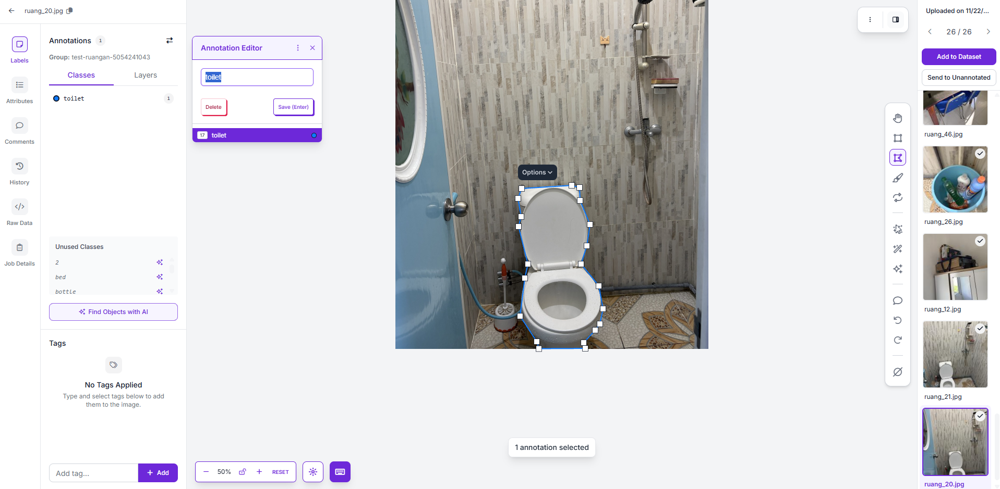 | 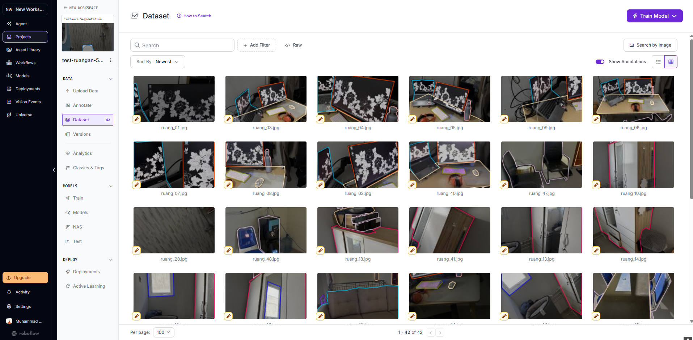 |

## 3. Model

| | YOLO11n-seg | YOLOv8n-seg | Mask R-CNN R50-FPN v2 |
|---|---|---|---|
| Keluarga | one-stage | one-stage | two-stage |
| Parameter | 2,88 M | 3,41 M | 46,27 M |
| Cara membentuk mask | 32 **prototype mask 160×160** (¼ resolusi input 640) × koefisien per objek, lalu dipotong box | sama (prototype 160×160) | RPN → RoIAlign 14×14 → head mask **28×28 per RoI**, di-upsample ke ukuran box |
| Backbone/neck | C3k2 + C2PSA (attention ringan) | C2f | ResNet-50 + FPN |
| Kecepatan (T4, ms/citra) | ~24 | ~23 | ~139 |

Konsekuensi yang diuji di §9:
- **YOLO**: satu piksel prototype mewakili 4×4 piksel input 640, atau ±10×10 piksel foto asli 1600 px. Akibatnya, tepi objek tipis cenderung kasar.
- **Mask R-CNN**: resolusi mask tetap 28×28 berapa pun ukuran objek. Pada objek besar, satu sel grid mewakili area yang sangat luas.

## 4. Hipotesis

Ditulis di [`docs/Logbook.md`](docs/Logbook.md) pada 24 Nov 2026, **sebelum** run tambahan Y8_50, Y8_25, MRCNN_50, dan MRCNN_25. Waktunya dapat dicek dari commit `Hipotesis sebelum run tambahan variabel NRP`.

> **Catatan kronologi**: ketentuan "hipotesis sebelum training" baru diumumkan setelah 5 run utama selesai (22 Nov), sehingga tanggalnya tidak dimundurkan.

Isi hipotesis (kutipan apa adanya):
> Model yang unggul kemungkinan adalah YOLO11n-seg karena model tersebut adalah model terbaru dari eksperimen ini. Kelas yang paling bagus kemungkinan adalah dining-table karena bentuk meja dataset dengan data test cukup mirip.

## 5. Hasil utama

Sumber: [`bukti/tabel_hasil_utama.csv`](bukti/tabel_hasil_utama.csv), dengan 100% data latih:

| Model | mAP50-95 asli | mAP50 asli | mAP75 asli | mAP50-95 sendiri | mAP50 sendiri | mAP75 sendiri | ms/citra | Latih (menit) |
|---|---|---|---|---|---|---|---|---|
| YOLO11n-seg | 0,094 | 0,154 | 0,092 | **0,148** | **0,233** | **0,162** | 25 | 19,3 |
| YOLOv8n-seg | 0,078 | 0,124 | 0,078 | 0,097 | 0,142 | 0,100 | 22 | 19,3 |
| Mask R-CNN | **0,095** | **0,157** | **0,099** | 0,117 | 0,194 | 0,115 | 139 | 37,5 |

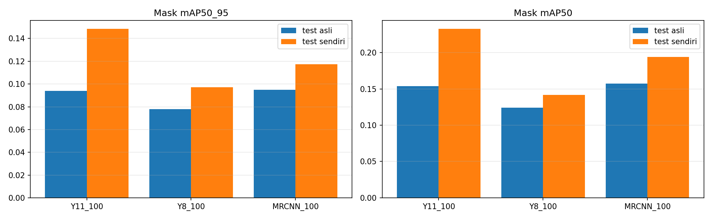

Kurva training ([`bukti/results_*.csv`](bukti/)):

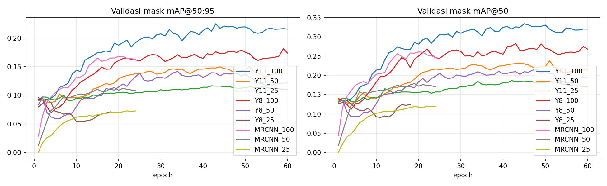

Angka mAP absolut rendah (<0,1 di test asli) karena:
- Data latih hanya 397 citra untuk 74 kelas yang punya instance (dari 93 nama kelas di `data.yaml`).
- Banyak kelas *stuff* yang batasnya kabur.
- Satu citra test asli rata-rata berisi 14,9 objek, banyak di antaranya kecil.

Cek silang: notebook membandingkan metrik bawaan Ultralytics dengan COCOeval pada data yang sama, dan hasil keduanya konsisten (bagian evaluasi notebook).

## 6. Domain shift: test asli vs test sendiri

### 6.1 Kenapa skor test sendiri justru lebih tinggi?

Selisih mAP50-95 (asli − sendiri) bernilai negatif untuk semua model 100%: YOLO11 −0,054, YOLOv8 −0,019, Mask R-CNN −0,022. Ini **bukan** berarti tidak ada domain shift. Dua kemungkinan penyebabnya bisa dibedakan:

1. **Set kelas berbeda.** COCOeval merata-ratakan AP hanya pada kelas yang muncul di ground truth: 69 kelas di test asli, 18 kelas di test sendiri.
2. **Komposisi adegan berbeda.** Test sendiri berisi 3,8 objek/citra yang umumnya besar dan difoto dari dekat, sedangkan test asli berisi 14,9 objek/citra.

Untuk memisahkannya, AP dirata-ratakan **hanya pada 18 kelas yang sama** (`bukti/ap_per_kelas.csv`):

| Model | Test asli (18 kelas) | Test sendiri (18 kelas) |
|---|---|---|
| YOLO11n-seg | 0,077 | 0,148 |
| YOLOv8n-seg | 0,067 | 0,097 |
| Mask R-CNN | 0,090 | 0,117 |

Pada kelas yang sama pun test sendiri tetap lebih tinggi. Jadi penyebab utamanya adalah **komposisi adegan**: objek di fotoku lebih besar dan lebih sedikit, sehingga lebih mudah. Domain shift yang merugikan tetap ada, tetapi muncul per kelas (§6.2).

### 6.2 AP per kelas (100% data)

| Kelas | Instance latih | AP test asli (Y11 / Y8 / MRCNN) | AP test sendiri (Y11 / Y8 / MRCNN) |
|---|---|---|---|
| laptop | 8 | 0,31 / 0,30 / 0,29 | **0,69** / 0,49 / 0,38 |
| couch | 18 | 0,13 / 0,02 / 0,13 | **0,55** / 0,10 / 0,20 |
| chair | 217 | 0,26 / 0,18 / 0,28 | 0,32 / 0,31 / 0,34 |
| trash-bin | 153 | 0,04 / 0,02 / 0,07 | 0,30 / 0,30 / **0,48** |
| door-stuff | 64 | 0,09 / 0,04 / 0,16 | 0,21 / 0,08 / 0,19 |
| bed | 26 | 0,22 / 0,14 / 0,15 | **0,03 / 0,00 / 0,08** ↓ |
| bottle | 62 | 0,14 / 0,15 / 0,24 | 0,03 / 0,16 / 0,19 |
| cabinet-merged | 47 | 0,01 / 0,01 / 0,08 | 0,02 / 0,00 / 0,02 |
| box | 95 | 0,00 / 0,00 / 0,00 | 0,01 / 0,00 / 0,03 |
| tv, keyboard, mouse, toilet, dining table, handbag | 0–5 | ≈0 | **0 / 0 / 0** |

Kelas yang **turun** di fotoku adalah `bed` dan `bottle` (Y11). Kasur kos tanpa rangka yang difoto dari dekat berbeda dari kasur di dataset. Kelas yang **naik** (laptop, couch) adalah objek besar dan terisolasi.

### 6.3 Per kondisi foto (mAP50, `bukti/mAP50_per_kondisi.csv`)

| Kondisi (jumlah foto) | YOLO11 | YOLOv8 | Mask R-CNN |
|---|---|---|---|
| normal (30) | 0,270 | 0,179 | 0,254 |
| oklusi (4) | 0,168 | 0,137 | **0,221** |
| redup (5) | **0,231** | 0,209 | 0,179 |
| sudut ekstrem (2) | 0,333 | 0,167 | 0,333 |
| backlight (1) | 0,389 | 0,223 | 0,389 |
| semua sulit (12) | **0,302** | 0,151 | 0,182 |

- **Oklusi**: Mask R-CNN paling tahan (0,221 vs 0,168). Mekanismenya two-stage: RPN mengusulkan banyak region, lalu setiap RoI disegmentasi terpisah, sehingga objek yang saling menutupi tidak mudah tergabung.
- **Redup**: YOLO lebih tahan daripada Mask R-CNN. Augmentasi HSV (`hsv_v=0.4`) yang aktif saat training YOLO membuat model terbiasa dengan variasi kecerahan, sedangkan training Mask R-CNN tidak memakai augmentasi kecerahan.
- Kategori sudut ekstrem (2 foto) dan backlight (1 foto) terlalu kecil untuk disimpulkan, jadi hanya ditampilkan sebagai catatan.

## 7. Variabel NRP: jumlah data latih (25/50/100%)

Sumber: [`bukti/tabel_variabel_nrp.csv`](bukti/tabel_variabel_nrp.csv), mask mAP50-95:

| Model | Data | Test asli | Test sendiri | Selisih (asli − sendiri) | Latih (menit) |
|---|---|---|---|---|---|
| YOLO11n-seg | 25% | 0,066 | 0,149 | −0,082 | 7,9 |
| | 50% | 0,074 | 0,167 | −0,093 | 11,8 |
| | 100% | 0,094 | 0,148 | −0,054 | 19,3 |
| YOLOv8n-seg | 25% | 0,105 | 0,236 | −0,131 | 2,5 |
| | 50% | 0,068 | 0,151 | −0,083 | 10,9 |
| | 100% | 0,078 | 0,097 | −0,019 | 19,3 |
| Mask R-CNN | 25% | 0,037 | 0,029 | +0,008 | 20,5 |
| | 50% | 0,067 | 0,070 | −0,003 | 24,8 |
| | 100% | 0,095 | 0,117 | −0,022 | 37,5 |

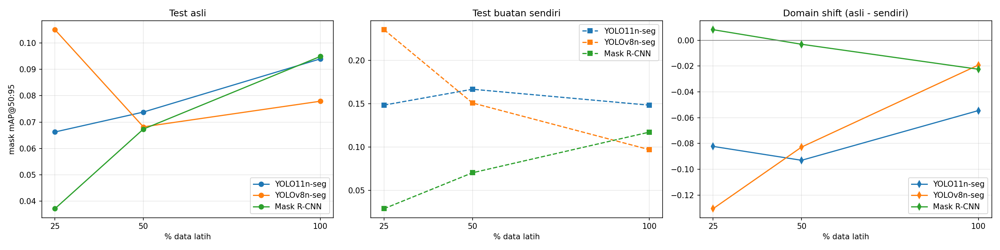

**Temuan:**

1. **Mask R-CNN paling bergantung pada jumlah data.** Test asli naik 2,6× dari 25% ke 100% data (0,037 → 0,095), dan test sendiri naik 4× (0,029 → 0,117).
   - Pada Mask R-CNN, **seluruh** head untuk 93 kelas (+ latar) harus dilatih ulang dari awal: classifier box, regresi box, dan head mask 28×28. Dengan 99 citra, head ini kekurangan contoh.
   - Model two-stage juga punya 16× lebih banyak parameter.
2. **YOLO11 naik konsisten di test asli** (0,066 → 0,074 → 0,094), tetapi **datar di test sendiri** (0,149 / 0,167 / 0,148).
   - Data tambahan hanya membantu pada distribusi yang sama dengan data latih. Domain shift tidak mengecil.
   - Selisih ±0,02 di test sendiri setara beberapa objek saja, karena test sendiri hanya berisi 158 objek. Fluktuasi ini masih dalam batas noise.
3. **Anomali YOLOv8 25%: skor terendah di val, tertinggi di kedua test.**
   - Training berhenti oleh EarlyStopping di epoch 18, dan `best.pt` diambil dari **epoch 3** (val mask mAP50-95 0,093; `bukti/results_Y8_25.csv`).
   - Pada YOLOv8, mAP val sempat turun di awal training lalu naik lagi; contohnya Y8_50 turun dari 0,096 (epoch 2) ke 0,059 (epoch 6), lalu naik ke 0,142 (epoch 34). Untuk Y8_25, kenaikan kembali itu tidak terjadi dalam 15 epoch, sehingga bobot yang tersimpan masih dekat dengan bobot pretrained **COCO**.
   - Kelas yang paling berpengaruh di fotoku (chair, laptop, couch, bed, tv, bottle, toilet) adalah kelas COCO. Jadi model yang belum "melupakan" COCO justru unggul.
   - Bukti pendukung: Y8_25 juga tertinggi di test asli (0,105), padahal val-nya paling rendah. Artinya val 166 citra tidak memprediksi test dengan baik. Selain itu, terjadi *catastrophic forgetting* saat fine-tuning ke 93 kelas dengan data sedikit.
   - Ini masih dugaan, belum dibuktikan langsung. Cara mengujinya: evaluasi bobot pretrained COCO tanpa fine-tuning dengan pemetaan nama kelas COCO ke kelas dataset.
4. **Waktu latih** YOLO berbanding hampir lurus dengan jumlah data. Mask R-CNN 25% tetap butuh 20 menit. Kemungkinan besar penyebabnya adalah evaluasi COCO pada 166 citra val di setiap epoch, yang ukurannya tidak ikut mengecil.

## 8. Evaluasi hipotesis

| Hipotesis | Hasil | Penjelasan |
|---|---|---|
| YOLO11n-seg unggul | **Sebagian terbukti** | Dengan 100% data, YOLO11 terbaik di test sendiri (0,148) dan pada foto sulit (mAP50 0,302), tetapi seri dengan Mask R-CNN di test asli. Alasan "model terbaru" tidak cukup. Penjelasan yang didukung data: modul attention C2PSA dan C3k2 membuat YOLO11 lebih efisien parameter dibanding YOLOv8 (2,88 M vs 3,41 M, tetapi mAP lebih tinggi). Namun YOLO11 tidak unggul di semua variasi jumlah data: Y8_25 lebih tinggi, lihat §7. |
| Kelas terbaik `dining table` | **Tidak terbukti** | AP `dining table` = **0** di ketiga model. Dataset melabeli meja sebagai `table-merged` (319 instance latih), sedangkan `dining table` hanya 4. Model sebenarnya mengenali mejaku: Mask R-CNN memprediksi `table-merged` dengan skor 0,98 di `ruang_08` (§9). Prediksi itu tetap dihitung salah karena label anotasiku berbeda. Kelas terbaik sebenarnya adalah `laptop` (AP 0,69) dan `couch` (0,55), yaitu objek besar dan terisolasi dari kelas COCO. |

## 9. Analisis 5 kegagalan + eksperimen pembuktian

Foto dipilih dari diagnosis otomatis `bukti/diagnosis_per_foto_Y11_100.csv`, yaitu foto dengan F1 = 0, lalu disaring agar mewakili jenis kegagalan yang berbeda. Setiap gambar berisi ground truth diikuti prediksi YOLO11, YOLOv8, dan Mask R-CNN (skor ≥ 0,3).

### Kegagalan 1 — `ruang_08`: meja terdeteksi, tetapi beda nama kelas (*label/taxonomy shift*)
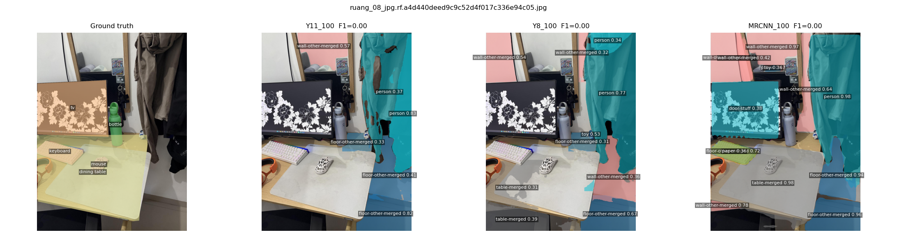
- **Yang terjadi**: Mask R-CNN memprediksi meja sebagai `table-merged` dengan skor 0,98, dan YOLOv8 dengan skor 0,31–0,39. Ground truth menyebutnya `dining table`, sehingga prediksi itu dihitung FP dan objeknya FN. Jaket yang tergantung terdeteksi sebagai `person` dengan skor 0,83–0,98.
- **Mekanisme**: modelnya tidak salah melihat. Yang berbeda adalah **definisi kelas** antara dataset dan anotasiku. Kesalahan `person` muncul karena jaket tergantung punya siluet mirip tubuh manusia, dan `person` adalah kelas dengan 192 instance latih.
- **Bukti**: lihat Eksperimen E1 dan statistik `table-merged` 319 vs `dining table` 4 instance latih.

### Kegagalan 2 — `ruang_02`: kelas yang tidak pernah dilihat saat training
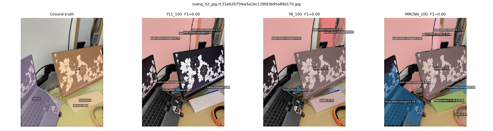
- **Yang terjadi**: monitor (GT `tv`) diprediksi sebagai `wall-other-merged` atau `wallet`. Keyboard diprediksi sebagai `wallet` atau `floor`. Laptop tidak terdeteksi oleh YOLO.
- **Mekanisme**: `keyboard` punya **0** instance latih dan `tv` hanya 2. Head klasifikasi tidak punya bobot yang bermakna untuk kelas-kelas itu, sehingga objek dialihkan ke kelas mirip yang sering muncul. Wallpaper bunga di layar juga membuat monitor bertekstur seperti dinding.
- **Bukti**: Eksperimen E1.

### Kegagalan 3 — `ruang_10`: lemari besar dikira dinding (bias kelas *stuff*)
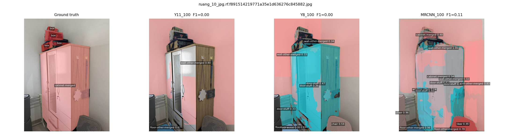
- **Yang terjadi**: lemari putih (GT `cabinet-merged`) disegmentasi sebagian sebagai `wall-other-merged` (YOLO11, skor 0,80) atau `door-stuff` (YOLOv8). Mask R-CNN menghasilkan banyak potongan mask yang tumpang tindih.
- **Mekanisme**:
  - Permukaan lemari datar, putih, dan menempel ke dinding putih, jadi kontras tepinya rendah. Pada saat yang sama, `wall-other-merged` adalah kelas terbanyak (756 instance latih), sehingga model bias ke kelas itu untuk permukaan datar.
  - Di Mask R-CNN, objek sebesar hampir seluruh foto hanya diwakili grid **28×28**. Akibatnya beberapa RoI yang tumpang tindih menghasilkan mask terpisah dan tidak lolos NMS sebagai satu objek.
- **Bukti**: Eksperimen H1, yang menguji efek resolusi mask pada objek besar.

### Kegagalan 4 — `ruang_12` (oklusi): kotak bertumpuk
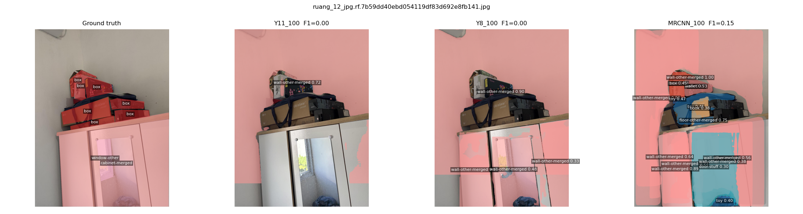
- **Yang terjadi**: 7 kotak bertumpuk di atas lemari. YOLO menganggap seluruh tumpukan sebagai bagian dinding. Mask R-CNN hanya menemukan 1 `box` (0,45), sementara bagian lainnya dilabeli `toy`, `book`, atau `wallet`.
- **Mekanisme**:
  - Pada objek yang saling menutupi, tepi antar-kotak tidak terlihat. YOLO memotong mask dengan bounding box, sehingga satu box besar menelan beberapa kotak.
  - Mask R-CNN lebih baik di oklusi (mAP50 0,221 vs 0,168, §6.3) karena memproses setiap RoI secara terpisah, tetapi kelasnya tetap kacau.
  - Kotak di data latih (95 instance) sebagian besar kardus cokelat. Kotak sepatu merah di fotoku berbeda warna dan bentuknya.
- **Bukti**: mAP50 per kondisi (§6.3) dan Eksperimen E1. AP `box` ≈ 0 meski punya 95 instance latih, sehingga masalahnya adalah tampilan yang berbeda, bukan jumlah data.

### Kegagalan 5 — `ruang_13`: lemari bercermin
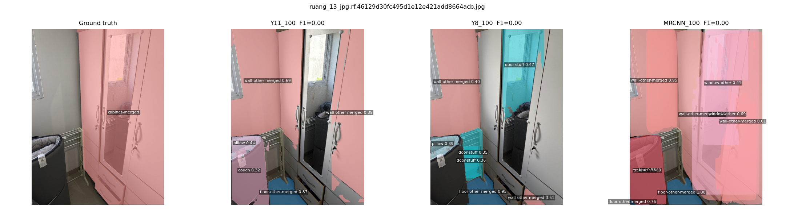
- **Yang terjadi**: lemari (GT `cabinet-merged`) terpecah. Pintu kiri dan kanan dianggap `wall-other-merged`, sedangkan bagian cermin dianggap `window-other` (Mask R-CNN, 0,41–0,69) atau `door-stuff` (YOLOv8).
- **Mekanisme**: cermin memantulkan jendela dan isi kamar. Fitur lokal di area itu memang terlihat seperti jendela, dan model tidak punya konteks global bahwa pantulan itu berada di dalam lemari. Pada YOLO, mask yang terbentuk dari prototype mengikuti tepi kuat (bingkai cermin), sehingga satu objek terpecah menjadi beberapa bagian.

### Eksperimen pembuktian (tanpa training ulang)

**E1 — AP vs jumlah instance latih** (dihitung dari `statistik_dataset.csv` + `ap_per_kelas.csv`; menguji kegagalan 1, 2, 4):

| Instance latih per kelas | Kelas | Objek test sendiri | AP rata-rata Y11 / Y8 / MRCNN |
|---|---|---|---|
| < 10 | 7 | 57 (36%) | 0,099 / 0,069 / 0,055 |
| 10–49 | 5 | 32 | 0,203 / 0,058 / 0,079 |
| ≥ 50 | 6 | 69 | 0,160 / 0,162 / 0,223 |

Dari 7 kelas dengan <10 instance latih, 6 kelas mendapat AP tepat **0** pada ketiga model. Satu-satunya pengecualian adalah `laptop` (8 instance, AP 0,69), kelas COCO yang bentuknya khas. Hasil ini membuktikan bahwa kegagalan 1 dan 2 disebabkan oleh **data latih**, bukan arsitektur: ketiga model gagal dengan cara yang sama. Mask R-CNN paling diuntungkan oleh banyak data (0,223 pada kelas ≥50 instance), konsisten dengan temuan NRP di §7.

**H1 — Resolusi mask membatasi ketepatan tepi** (YOLO11_100, test sendiri; menguji kegagalan 3):

| Varian | Prototype | mAP50 | mAP75 | mAP50-95 | IoU rata-rata objek terdeteksi |
|---|---|---|---|---|---|
| imgsz 640 | 160×160 | 0,233 | 0,162 | 0,148 | 0,806 |
| imgsz 640 + `retina_masks` | 160×160 | 0,233 | 0,162 | 0,149 | 0,807 |
| imgsz 960 | 240×240 | 0,129 | 0,089 | 0,091 | **0,860** |
| imgsz 960 + `retina_masks` | 240×240 | 0,129 | 0,089 | 0,092 | **0,860** |

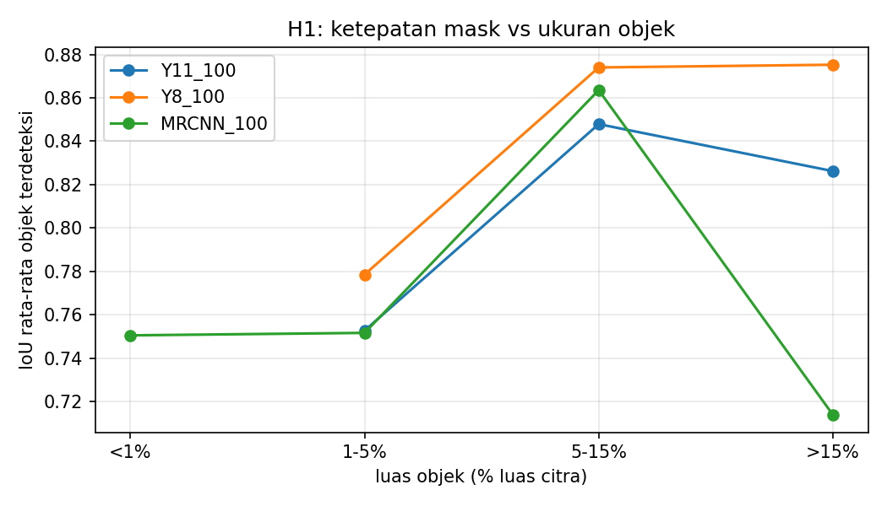

Hasilnya **sebagian mendukung** hipotesis:
- Prototype yang lebih besar membuat tepi mask lebih tepat; IoU objek yang terdeteksi naik dari 0,806 ke 0,860.
- Namun mAP turun hampir setengah, karena model dilatih pada skala 640. Di 960, objek tampak lebih besar daripada yang pernah dilihat model, sehingga lebih banyak objek tidak terdeteksi.
- `retina_masks` hampir tidak berpengaruh. Artinya kekasaran tepi berasal dari resolusi prototype itu sendiri, bukan dari tahap upsampling.

**H2 — Kegagalan di foto sulit karena pencahayaan** (CLAHE + gamma 0,6 pada 12 foto sulit; mAP50 / mAP50-95):

| Model | Input asli | Setelah CLAHE + gamma |
|---|---|---|
| YOLO11n-seg | **0,296 / 0,226** | 0,222 / 0,168 |
| YOLOv8n-seg | **0,210 / 0,169** | 0,123 / 0,106 |
| Mask R-CNN | 0,185 / 0,139 | **0,225 / 0,156** |

Hipotesis ini **ditolak untuk YOLO** dan hanya sedikit didukung untuk Mask R-CNN.
- Koreksi cahaya justru menurunkan skor YOLO sekitar 25%. Kecerahan foto "sulit" ternyata tidak terlalu ekstrem (rata-rata 99,8 vs 139,6 pada foto normal), karena HDR iPhone sudah meratakannya. Selain itu, YOLO sudah dilatih dengan augmentasi HSV.
- CLAHE menambah kontras lokal dan memperkuat noise ISO tinggi, sehingga distribusi piksel menjauh dari data latih.
- Mask R-CNN, yang dilatih tanpa augmentasi kecerahan, sedikit terbantu.
- Kesimpulannya: kegagalan di foto sulit lebih banyak disebabkan oleh **oklusi dan kelas** daripada oleh cahaya.

## 10. Bukti proses

| Bukti | Lokasi |
|---|---|
| Riwayat commit Git (bertahap) | repo ini: `git log` |
| Log training per epoch (`results.csv`) | [`bukti/results_<run>.csv`](bukti/), 9 run |
| Waktu GPU | [`bukti/gpu_time_log.csv`](bukti/gpu_time_log.csv): tabel di bawah |
| Logbook mingguan + hipotesis | [`docs/Logbook.md`](docs/Logbook.md) |
| Notebook beserta output | [`notebook/segmentasi_instance_5054241043.ipynb`](notebook/segmentasi_instance_5054241043.ipynb) |
| Screenshot anotasi, EXIF | [`bukti/screenshot_anotasi/`](bukti/screenshot_anotasi/), [`bukti/metadata_exif.csv`](bukti/metadata_exif.csv) |
| Deklarasi AI (prompt utama + kasus AI salah) | [`docs/Penggunaan_AI.md`](docs/Penggunaan_AI.md) |

| Run | Mulai (UTC) | Durasi GPU T4 (menit) |
|---|---|---|
| Y11_100 | 22 Nov 12:40 | 19,25 |
| Y11_50 | 22 Nov 12:59 | 11,83 |
| Y11_25 | 22 Nov 13:11 | 7,90 |
| Y8_100 | 22 Nov 13:19 | 19,28 |
| MRCNN_100 | 22 Nov 13:38 | 37,47 |
| Y8_50 | 24 Nov 15:45 | 10,89 |
| Y8_25 | 24 Nov 15:56 | 2,46 |
| MRCNN_50 | 24 Nov 15:59 | 24,84 |
| MRCNN_25 | 24 Nov 16:23 | 20,53 |
| **Total** | | **154,4** (semua < batas 2 jam/model) |

Ditambah 4,4 menit uji cepat pipeline pada 22 Nov (folder terpisah).

**Demo**: bagian 8 notebook menjalankan inferensi pada foto baru (`FOTO_DEMO`, `MODEL_DEMO`, `CONF_DEMO`), dan bagian 8.1 memproses semua foto di folder Drive `Tugas3_Segmentasi/demo/` sekaligus (foto HEIC iPhone otomatis dikonversi). Fungsi `ap_kelas('chair')` menampilkan AP satu kelas untuk 9 model.

## 11. Keterbatasan

- Test set sendiri kecil (42 foto, 158 objek). Selisih mAP sekitar ±0,02 setara beberapa objek, sehingga belum tentu bermakna.
- Kategori sudut ekstrem (2 foto) dan backlight (1 foto) terlalu sedikit untuk disimpulkan.
- Setiap konfigurasi hanya dijalankan **sekali** (satu seed). Variasi antar-seed tidak diukur, padahal anomali Y8_25 menunjukkan hasil bisa sangat bergantung pada epoch mana yang terpilih.
- Pilihan label `dining table` dan `tv` di anotasiku tidak sesuai dengan kebiasaan pelabelan dataset (`table-merged`). Jika anotasi diganti, AP test sendiri akan berubah. Perubahan ini belum dilakukan, supaya test set tidak "disesuaikan" setelah melihat hasil.
- EarlyStopping patience 15 sama untuk semua run YOLO. Untuk data 25%, nilai ini terlalu pendek.

## 12. Struktur repo & cara menjalankan ulang

```
Tugas-3/
├── README.md                                  laporan ini
├── notebook/segmentasi_instance_5054241043.ipynb   notebook utama (Colab) + output run 24 Nov
├── scripts/siapkan_foto.py                    konversi HEIC -> JPG, tabel EXIF, saran kondisi sulit
├── data/kondisi_foto.csv                      kondisi tiap foto test sendiri
├── bukti/                                     results.csv 9 run, GPU log, tabel hasil, EXIF, screenshot anotasi
├── hasil/gambar/                              grafik & visualisasi kegagalan
└── docs/                                      Logbook.md, Penggunaan_AI.md
```

Tidak di-commit (`.gitignore`):
- `foto/`: foto asli HEIC berisi GPS. Test set tersimpan di project Roboflow privat.
- `materi/`: PDF materi.
- Bobot model, tersimpan di Google Drive `MyDrive/Tugas3_Segmentasi/`.

**Menjalankan ulang di Colab:**
1. Unggah notebook dan pilih *Runtime → T4 GPU*.
2. Simpan API key Roboflow di **Colab Secrets** dengan nama `ROBOFLOW_API_KEY`.
3. Unggah `data/kondisi_foto.csv` ke `MyDrive/Tugas3_Segmentasi/`.
4. Pilih *Run all*. Run yang sudah selesai (punya file `SELESAI` di Drive) otomatis dilewati, sehingga hanya evaluasi yang berjalan, sekitar 20 menit.

Menyiapkan foto baru: `python scripts/siapkan_foto.py foto/asli_heic`, yang menghasilkan `foto/jpg/`, `bukti/metadata_exif.csv`, dan `data/kondisi_foto.csv`.
